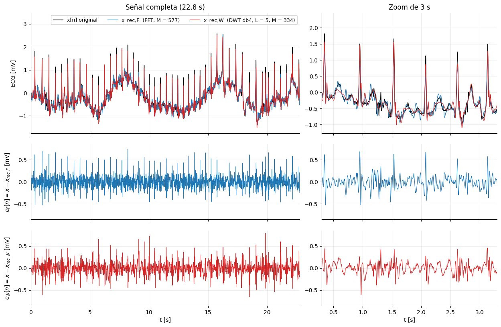
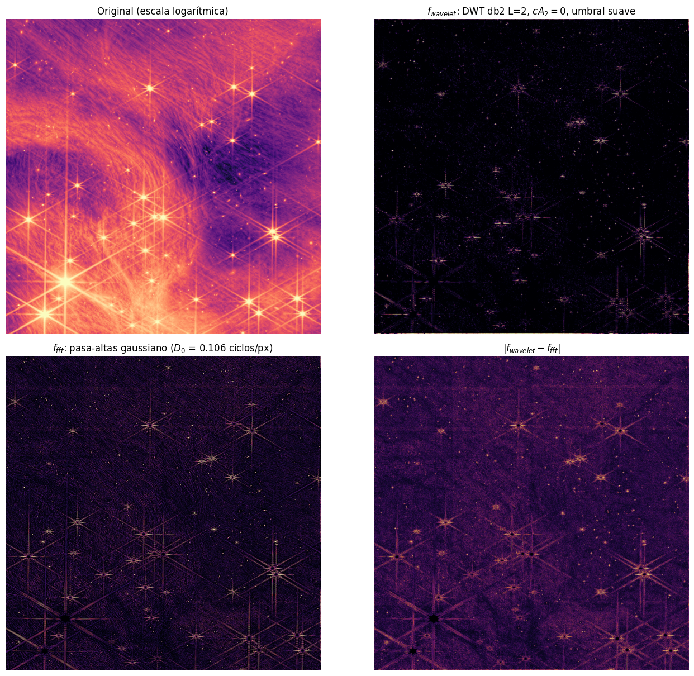

# FFT frente a wavelets: compresión de un ECG y aislamiento de fuentes en una imagen del JWST

Taller de **reducción de dimensionalidad, análisis espectral y transformadas integrales**.
Compara la transformada rápida de Fourier (FFT) con la transformada wavelet discreta (DWT) en dos problemas: comprimir un electrocardiograma (Ejercicio 1) y aislar fuentes puntuales en una imagen del telescopio James Webb (Ejercicio 2).

**Autores:** Juan Esteban Martinez Herrera · Juan David Cuartas
**Instituciones:** Universidad del Quindío · Universidad del Valle
**Asignatura:** Métodos de Machine Learning en Ciencias e Ingenierías (106023C), 2026A

## Qué hay en el repositorio

| Archivo o carpeta | Contenido |
|---|---|
| [`Taller4_FFT_Wavelets.ipynb`](Taller4_FFT_Wavelets.ipynb) | Cuaderno ejecutado, con todas las salidas, figuras y discusiones |
| [`figuras/`](figuras) | Las 15 figuras del cuaderno en PNG |
| `construir.py` y demás `.py` | Generador que ensambla, ejecuta y verifica el cuaderno |
| [`data/`](data) | ECG y datos de respaldo. La imagen original del JWST no se incluye por su tamaño |
| [`COMO_EJECUTAR.md`](COMO_EJECUTAR.md) | Guía detallada y problemas frecuentes |

Si GitHub tarda en mostrar el cuaderno (pesa unos 11 MB), pegue la dirección del archivo en [nbviewer.org](https://nbviewer.org).

## Resultados principales

**Ejercicio 1: ECG (MIT-BIH, registro 208, N = 8192 muestras), 95 % de la energía.**
A igual error, la DWT necesita menos coeficientes, y conserva mejor el pico R del latido.

| | FFT | DWT (db4, L = 5) |
|---|---|---|
| Coeficientes M | 577 | 334 |
| Razón de compresión (CR = N/M) | 14.2 | 24.5 |
| MSE [mV²] | 0.01629 | 0.01621 |
| M medio en 13 segmentos | 515 ± 164 | 289 ± 54 |
| Retención del pico R (media de 13 segmentos) | 0.72 | 0.83 |

El MSE es igual porque ambas bases son ortonormales (Parseval). Fuera de los complejos QRS gana la FFT, y con solo el 80 % de la energía también.



**Ejercicio 2: imagen JWST de IC 348 (2048 × 2048 px tras promediar en bloques de 3 × 3), 37 fuentes de referencia.**

| Medida | Wavelet db2, L = 2 (umbral suave) | FFT pasa-altas gaussiano |
|---|---|---|
| Posición del máximo a ≤ 1 px | 92 % | 100 % |
| Correlación de forma | 0.60 | 0.88 |
| RMS en cielo vacío | 0.0050 | 0.0112 |

La wavelet deja el cielo 2.2 veces más limpio; la FFT gaussiana conserva mejor la forma. El efecto Gibbs aparece con el filtro ideal (99 % de la energía a 42 px), no con el gaussiano (4 px). Con el 5 % de los coeficientes, db2 con L = 2 tiene un MSE 205 veces mayor que la FFT porque su banda cA₂ ocupa el 6.25 % de los coeficientes; con L ≥ 3 las wavelets quedan entre 0.82 y 0.96 veces el MSE de la FFT.



## Cómo reproducirlo

Probado con Python 3.13.

```
pip install -r requirements.txt
python construir.py                                         # con la imagen de respaldo (Hubble)
python construir.py --imagen data/epico.tif --reducir 3     # con la imagen del taller (hay que descargarla)
```

Genera el cuaderno ejecutado, `resultados.json` y las figuras. Más opciones y soluciones a errores comunes en [`COMO_EJECUTAR.md`](COMO_EJECUTAR.md).

## Límites

* IC 348 es una región de formación estelar con nebulosa, no un campo profundo. El «cielo vacío» es relativo.
* La imagen es una composición en color de prensa convertida a luminancia, no flujo lineal; los MSE son relativos a la escala [0, 1].
* Un solo registro de ECG, una sola imagen y 37 fuentes de referencia elegidas sobre la propia imagen. El CR cuenta coeficientes, no bits.

## Datos y referencias

* ECG: MIT-BIH Arrhythmia Database, registro 208 (Moody y Mark, 2001; Goldberger et al., 2000, PhysioNet).
* Imagen: JWST NIRCam, región IC 348. Crédito: https://science.nasa.gov/asset/webb/ic-348-nircam-image-2/.
* Mallat, S. (2009). *A Wavelet Tour of Signal Processing*. Academic Press.
* Donoho, D. L. y Johnstone, I. M. (1994). Ideal spatial adaptation by wavelet shrinkage. *Biometrika* 81(3).
* Los enunciados y las diapositivas del curso no se incluyen.
